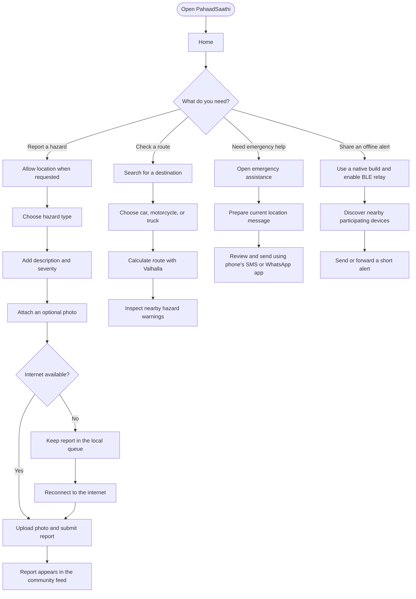
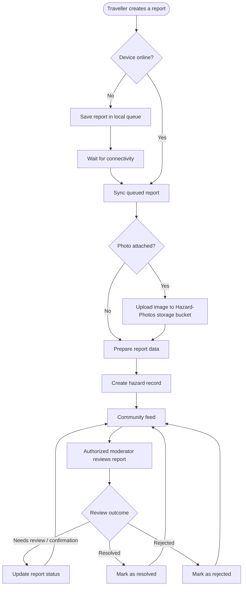
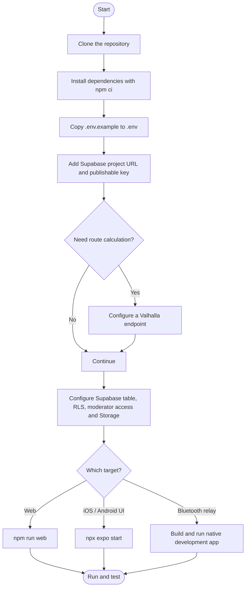

<div align="center">
  

  <p><strong>A community-powered safety companion for mountain journeys.</strong></p>

  <p>
    
    
    
    
  </p>

  <p>
    <a href="#-overview">Overview</a> ·
    <a href="#-how-to-use-pahaadsaathi">How to use</a> ·
    <a href="#-quick-start">Quick start</a> ·
    <a href="#-backend-setup">Backend setup</a> ·
    <a href="#-build-and-release">Build</a>
  </p>
</div>

---

## 🏔️ Overview

**PahaadSaathi** is a cross-platform mountain-travel safety app built with **Expo, React Native and TypeScript**. It helps travellers report road and weather hazards, explore routes with nearby risk information, browse community reports, and prepare an emergency location message.

When mobile data is unavailable, the native app can also relay short safety alerts to nearby PahaadSaathi devices over Bluetooth Low Energy (BLE). This uses a store-and-forward approach: participating phones can pass an alert onward when they encounter one another.

The idea is simple: make useful, location-aware safety information easier to share across mountain communities.

> [!IMPORTANT]
> **PahaadSaathi is a community aid, not an emergency service.** It does not replace official road closures, weather bulletins, rescue teams, or emergency operators. In India, call **112** for immediate danger. Never delay seeking official help while waiting for a community report or Bluetooth relay.

## ✨ Features

| Feature | What it does | Availability / notes |
| --- | --- | --- |
| **Hazard reporting** | Report landslides, damaged roads, waterlogging, accidents, fallen trees, and other hazards with a description, severity, coordinates, and optional photo. | Photo upload requires the Supabase Storage configuration. |
| **Community hazard feed** | Browse recent reports, inspect severity and status, and open report details. | Uses the configured Supabase backend when connected. |
| **Offline report queue** | Keep reports on the device while offline and sync queued reports when connectivity returns. | Local queue; do not assume an unuploaded photo is already online. |
| **Route planning** | Search for places, choose a car, motorcycle, or truck profile, and calculate a route using a Valhalla-compatible service. | Requires `EXPO_PUBLIC_VALHALLA_URL`. |
| **Route hazard awareness** | Inspect community hazards near a calculated route. | Depends on available hazard data and the configured services. |
| **Emergency assistance** | Open emergency calling options and prepare a location message for SMS or WhatsApp. | The user reviews and sends the message in their messaging app; it is not silently sent. |
| **Bluetooth safety relay** | Discover nearby compatible devices and send or forward short alerts using BLE store-and-forward. | Native development/release build only; not available in Expo Go or the web app. |
| **Moderator dashboard** | Allow authorized moderators to review reports, update report status, and apply vehicle restrictions. | Supabase Auth plus an authorized `moderators` membership row. |
| **Light and dark themes** | Switch between light and dark appearance. | Preference is saved on the device. |
| **Responsive interface** | Use the app's home, report, and feed experiences across mobile and web layouts. | Bluetooth relay is native-only. |

## 🧭 How to use PahaadSaathi

The diagrams below show the main traveller journeys and the report lifecycle. GitHub renders these Mermaid diagrams directly in the README.

### 1. Traveller journey



### 2. Hazard report lifecycle



**Important:** the diagram describes the intended online/offline workflow at a high level. Actual photo upload requires the Storage bucket and policies to be configured. The README does not assume that photo files are uploaded while the device is offline.

### 3. Developer setup flow



## 📱 Main screens

| Screen | Purpose |
| --- | --- |
| **Home** | Shortcuts to hazard reporting, recent hazards, emergency tools, and Bluetooth relay state. |
| **Map** | Search destinations, calculate routes, select a vehicle profile, and inspect nearby hazards. |
| **Hazard details** | Read a report and share its safety card or location. |
| **Emergency assistance** | Open listed emergency hotlines or prepare an SMS/WhatsApp location message. |
| **Offline relay** | Enable Bluetooth discovery and inspect nearby relay devices and the message queue. |
| **Account / sign-in** | Save a traveller profile locally on the device. |
| **Moderator** | Authenticate with Supabase and review reports when the account is authorized. |

## 🧰 Technology stack

| Layer | Technologies |
| --- | --- |
| Mobile application | React Native 0.88, React 19, TypeScript 6 |
| App platform and navigation | Expo SDK 58, Expo Router, EAS Build |
| UI and device APIs | React Native SVG, Reanimated, Expo Image, Expo Location, Expo Image Picker, Expo SMS, Expo Sharing |
| Local persistence | Expo SQLite, AsyncStorage |
| Connectivity | NetInfo |
| Backend and storage | Supabase JavaScript client, Supabase Auth, Supabase Storage |
| Bluetooth | `munim-bluetooth`, `react-native-nitro-modules` |
| Routing and geocoding | Valhalla-compatible directions API, Photon geocoding, curated Himalayan location data |
| Supported targets | iOS, Android, and web; BLE relay is native-only |

## ⚙️ Requirements

- **Node.js 20 or newer** and npm.
- The repository and its lockfile (`package-lock.json`).
- An iOS or Android device/emulator for native development.
- A Supabase project for online hazard reports, moderator access, and photo storage.
- A Valhalla-compatible routing endpoint if route calculation is required.
- An Expo account for EAS cloud builds. iOS App Store distribution also requires Apple signing and the relevant developer account.

## 🚀 Quick start

### 1. Clone and install

```bash
git clone https://github.com/Sagar264offici/PahaadSaathi-MobileApp.git
cd PahaadSaathi-MobileApp
npm ci
```

### 2. Create your local environment file

```bash
cp .env.example .env
```

Open `.env` and fill in the variables listed below. Do not commit this file.

### 3. Start the app

```bash
npx expo start
```

Use the Expo development server to launch the app on a supported target. The web version can be started with:

```bash
npm run web
```

> [!NOTE]
> Expo Go is suitable for trying the web-compatible/mobile UI, but **it does not support the Bluetooth relay module**. BLE testing requires a native development build or release build with the required native dependencies and permissions.

### 4. Run a native development build

The repository provides these native commands:

```bash
npm run android
npm run ios
```

Run the command for the platform you have configured. Native toolchains, device permissions, and signing requirements still apply.

## 🔐 Environment variables

Create `.env` from `.env.example` for local development. Add the same `EXPO_PUBLIC_*` values to the EAS `production` environment before cloud builds.

| Variable | Required | Description |
| --- | --- | --- |
| `EXPO_PUBLIC_SUPABASE_URL` | Yes, for Supabase features | Supabase project URL. |
| `EXPO_PUBLIC_SUPABASE_PUBLISHABLE_KEY` | Yes, for Supabase features | Supabase publishable/anonymous client key. Database and Storage policies must still restrict access. |
| `EXPO_PUBLIC_VALHALLA_URL` | Only for route calculation | Base URL of a Valhalla-compatible `/route` API. |

**Security rule:** Expo public environment variables are bundled into the client application. Use only client-safe values. Never add a Supabase `service_role` key, database password, private token, or signing credential to `.env` values prefixed with `EXPO_PUBLIC_` or to the public repository.

## 🗄️ Backend setup

PahaadSaathi uses Supabase for hazard records, photo storage, and moderator authentication.

### 1. Create the Supabase project and `hazards` table

Create a table named `hazards` with the fields used by the app:

| Column | Purpose |
| --- | --- |
| `id` | Unique report identifier. |
| `type` | Hazard category. |
| `description` | Traveller-provided details. |
| `latitude` | Report latitude. |
| `longitude` | Report longitude. |
| `photo_url` | URL for the optional uploaded image. |
| `created_at` | Report creation time. |
| `status` | Current moderation/report status. |
| `severity` | Reported severity. |
| `blocked_vehicles` | Vehicle restrictions associated with the report. |

Use an ID type consistently with the app and configure suitable defaults for `id`, `created_at`, `status`, and `blocked_vehicles`.

### 2. Enable Row Level Security

Enable **Row Level Security (RLS)** on the relevant tables and create policies for the access patterns required by the app:

- Allow the intended public/traveller report creation and reading operations.
- Restrict report status changes and vehicle restrictions to authorized moderators.
- Protect moderator membership so ordinary users cannot grant themselves moderator access.

The publishable key is not a secret and does not bypass RLS. Do not launch with broad update permissions just to make the app work.

### 3. Configure moderator accounts

1. Create moderator accounts in **Supabase Auth**.
2. Create or configure a `moderators` table with a `user_id` column.
3. Add the UUID of each approved moderator account to that table.
4. Apply RLS so only authorized moderators can read membership and update reports.

**Traveller profiles are different:** the current traveller account screens store profiles locally on the device. They are not Supabase Auth accounts. Supabase Auth is used by the moderator flow.

### 4. Configure photo uploads

In the Supabase Dashboard:

1. Open **SQL Editor**.
2. Run [`supabase/storage.sql`](supabase/storage.sql) from this repository.
3. Confirm that the `Hazard-Photos` bucket and the required upload policies have been created.

The supplied storage script configures a **public bucket** and allows image uploads under `hazards/` for anonymous/authenticated app users. It limits uploads to **5 MB** and JPEG, PNG, or WebP formats.

> [!WARNING]
> A public bucket means anyone who obtains an object URL can view that image. Hazard photos may reveal a person's surroundings, location, vehicle, or identity. Review the bucket visibility and Storage policies before launch; public image URLs should never be treated as private files.

## 📡 Bluetooth relay: important limitations

The native app scans and advertises a PahaadSaathi BLE service, connects to compatible nearby phones, and transfers short alert messages in chunks. Received alerts are deduplicated and may be forwarded onward while relay is active.

- Users must grant the required Bluetooth permissions and enable relay.
- BLE relay requires a native development or release build; it is not available in Expo Go or the web app.
- Bluetooth range is local and varies with devices, terrain, obstacles, radio conditions, and operating-system behavior.
- Bluetooth does **not** transmit a message directly over 25 km.
- A message could travel farther only through a chain of participating phones that encounter one another and forward it.
- The app cannot guarantee that another phone will be available, that background relaying will occur, or that an alert will reach its destination.
- Manual pairing in system settings is not required by the described flow, but devices must still be nearby, compatible, and have relay enabled.

Treat BLE relay as an additional best-effort communication path—not as a replacement for cellular service or emergency response.

## 📦 Build and release

### 1. Install and configure EAS CLI

```bash
npm install --global eas-cli
eas login
eas build:configure
```

### 2. Configure the EAS environment

Add the required `EXPO_PUBLIC_*` values to the Expo dashboard's **production** environment (or configure them with EAS environment commands). Keep private credentials out of client-side variables.

### 3. Create a build

```bash
# Android installable APK for direct testing / sharing
eas build --profile preview --platform android

# Android store bundle (AAB)
eas build --profile production --platform android

# iOS App Store build (Apple signing required)
eas build --profile production --platform ios

# Build both platforms
eas build --profile production --platform all
```

EAS will guide you through Android signing-key creation and iOS signing setup. Store builds still require the relevant Google Play / App Store listing, review, and release steps. Keep signing credentials private and backed up.

## 🧪 Useful commands

| Command | Purpose |
| --- | --- |
| `npm start` | Start the Expo development server. |
| `npx expo start` | Start Expo explicitly. |
| `npm run android` | Build/run the native Android app locally. |
| `npm run ios` | Build/run the native iOS app locally. |
| `npm run web` | Start the web version. |
| `npm run lint` | Run Expo ESLint checks. |
| `npx tsc --noEmit` | Check TypeScript types without emitting files. |

Before submitting changes, run:

```bash
npx tsc --noEmit
npm run lint
```

## 🗂️ Project structure

```text
PahaadSaathi-MobileApp/
├── src/
│   ├── app/          # Expo Router screens and routes
│   ├── components/   # Shared UI components
│   ├── context/      # App theme provider
│   ├── data/         # Hazard and local profile state
│   ├── lib/          # Supabase, storage, location, routing, and BLE services
│   └── theme/        # Theme definitions
├── assets/           # App icons, images, and fonts
├── supabase/         # Supabase setup SQL
├── .env.example      # Environment variable template
└── README.md
```

## 🛡️ Privacy and operational checklist

Before making a public release, verify each item:

- [ ] Request location only when the user starts a feature that needs it.
- [ ] Explain what location and photo information is shared before submission.
- [ ] Confirm the Supabase RLS policies protect report updates and moderator access.
- [ ] Review Storage bucket visibility, upload limits, and access policies.
- [ ] Decide how long public hazard reports and image URLs should be retained.
- [ ] Keep `.env`, signing files, private keys, and service-role credentials out of Git.
- [ ] Test offline report queuing and reconnection/sync behavior on real devices.
- [ ] Test BLE with native builds and nearby physical devices; do not infer relay reliability from simulator tests.
- [ ] Make it clear that emergency SMS/WhatsApp messages are reviewed and sent by the user.
- [ ] Keep official emergency and road-safety information separate from community-submitted reports.

## 🤝 Contributing

Contributions are welcome. To keep changes easy to review:

1. Create a branch for your change.
2. Keep secrets and generated native build files out of commits.
3. Run `npx tsc --noEmit` and `npm run lint` before opening a pull request.
4. For Bluetooth or location issues, include the device model, OS version, build type, and steps to reproduce.

## 📄 License

See [`LICENSE`](LICENSE) for the project license.

---

<div align="center">
  <strong>Built for safer journeys through the mountains.</strong>
  <br />
  <sub>Stay aware. Share responsibly. Never replace official emergency guidance with an app alert.</sub>
</div>
