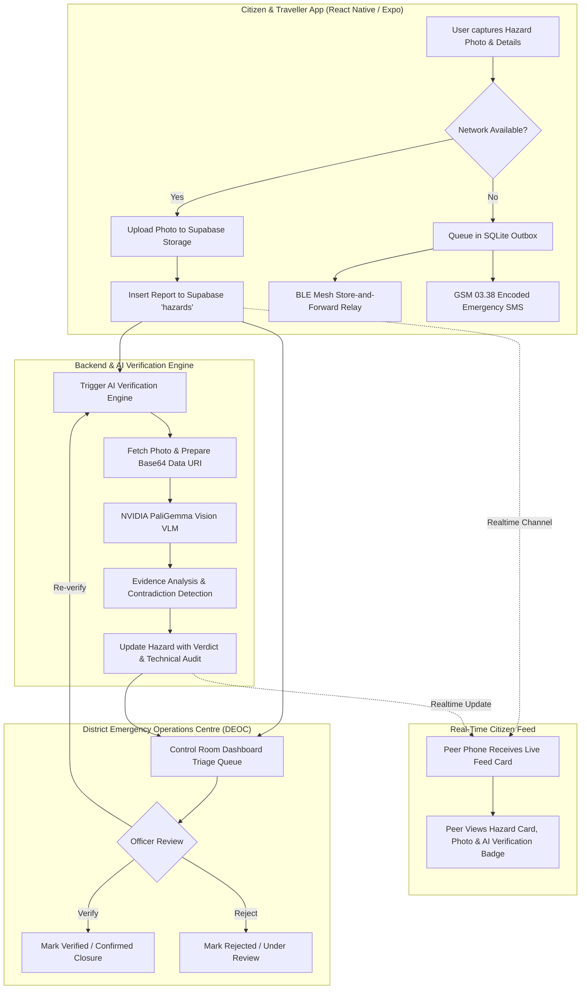

# PahaadSaathi 2.0 (पहाड़ साथी)

[]()
[]()
[]()
[]()
[]()
[]()

> **Autonomous Mountain-Road Safety, Offline BLE Mesh & NVIDIA AI Vision Verification Companion**  
> Built for the Himalayan terrain, Char Dham Yatra pilgrims, local mountain communities, and District Emergency Control Rooms in Uttarakhand.

---

## 🏔️ Overview

Travelling across high-altitude Himalayan corridors (Badrinath, Kedarnath, Joshimath, Uttarkashi, Devprayag, Dhari Devi) poses extreme hazards: sudden cloudbursts, falling rocks, seasonal landslides, road subsidence, and total cellular blackouts.

**PahaadSaathi 2.0** solves these challenges by combining:
1. **Instant Crowdsourced Hazard Reporting** with GPS coordinates and photo evidence.
2. **NVIDIA PaliGemma Vision AI Verification** running on the backend to evaluate visual photo evidence against reported claims, filtering misinformation and optical noise.
3. **Multi-Device Real-Time Sync & Feed** that immediately broadcasts verified hazards and photos from Phone A to Phone B across geographic wards.
4. **Offline-First Store-and-Forward Mesh** leveraging SQLite queues, BLE (Bluetooth Low Energy) multi-hop relays (up to 5 hops), and GSM 03.38 septet-counted Emergency SMS when Internet connectivity drops to zero.
5. **Smart Mountain Routing & 3-Letter Autocomplete** with curated Himalayan passes and Valhalla vehicle-specific hazard collision analysis (Car, 4x4, Motorcycle, Heavy Truck).
6. **District Control Room Dashboard** giving disaster response officers real-time triage tools, AI evidence audit trails, and road closure authority.

---

## 🔄 End-to-End System Workflow



### Detailed Workflow Stages

1. **Submission & Storage Resilience**:
   - The user selects a hazard category (Landslide, Rockfall, Flooding, Damaged Road, Tree Fall, Snow / Ice), attaches description, GPS coordinates, and a photo.
   - The photo is compressed and uploaded to the Supabase Storage bucket (`Hazard-Photos`). If network is down, the report is saved into a durable local SQLite outbox for automatic background retry with exponential backoff.
2. **NVIDIA PaliGemma AI Image Verification**:
   - The backend runs an image evidence analysis without exposing API keys to the client.
   - The model examines whether rocks, debris, soil, cracks, or flood waters are visually present and matches them against the user's textual claim.
   - Emits one of 4 standardized verdicts:
     - `CONSISTENT`: Photographic evidence directly substantiates the hazard.
     - `PARTIALLY_CONSISTENT`: Evidence partially supports claims, but severity may be overstated.
     - `INCONSISTENT`: The photograph directly contradicts the claim (e.g. user reports a blocked road, but photo shows clean highway).
     - `INSUFFICIENT_EVIDENCE`: Image is blurry, obstructed, dark, or lacks road context.
3. **Instant Cross-Device Feed**:
   - Supabase `postgres_changes` websocket channel relays new reports immediately to all active app instances within range.
   - Peer phones instantly see the new hazard card with high-resolution photo, severity status, and AI badge.
4. **Community Safety Ecosystem**:
   - Micro-community feeds partitioned by Tehsil (Joshimath, Kedarnath Valley, Chamoli, Uttarkashi).
   - Citizens and authorities share emergency hotlines, volunteer dispatch, shelter locations, and primary health centre (PHC) availability.
5. **District Control Room Action**:
   - Authorities retain ultimate decision authority (AI advises, human decides).
   - Officers can inspect the AI confidence breakdown, read detected visual evidence vs contradictions, and trigger manual re-verification with one click.

---

## 📂 Repository Structure

```text
├── assets/                     # App branding, icons, and static graphics
├── docs/                       # Technical design documents & architecture specs
│   ├── CURRENT_ARCHITECTURE.md # Full architecture review
│   ├── DATABASE_SCHEMA.md      # Postgres / PostGIS schema definitions
│   ├── OFFLINE_ENGINE.md       # BLE store-and-forward & SQLite outbox spec
│   └── SMS_ARCHITECTURE.md     # GSM 03.38 septet calculation & fallback spec
├── src/
│   ├── app/                    # Expo Router screens
│   │   ├── (tabs)/             # Tab navigation (Home, Community, Map, Profile)
│   │   ├── control-room/       # District Emergency Control Room officer portal
│   │   ├── hazard/[id].tsx     # Hazard detail view with AI Verification Card
│   │   ├── report.tsx          # Incident reporting flow with camera & GPS
│   │   └── community.tsx       # Local Tehsil ecosystem (Feed, Help, Volunteers, Shelters)
│   ├── components/             # Reusable UI components
│   │   ├── HazardVerificationStatus.tsx # 7-state AI verification evidence UI
│   │   ├── GooglePlaceAutocompletePicker.tsx # 3-letter instant mountain search
│   │   └── BottomNavigation.tsx# Native responsive tab bar
│   ├── data/                   # Data layers & MobX/reactive stores
│   │   ├── hazardStore.ts      # Multi-device sync, real-time feed & offline outbox
│   │   └── communityStore.ts   # Tehsil-level emergency directory & volunteer posts
│   ├── lib/
│   │   ├── hazardVerification.ts # Core NVIDIA PaliGemma verification engine
│   │   ├── storage.ts          # Resilient Supabase photo upload
│   │   ├── supabase.ts         # Supabase client singleton & offline fallback
│   │   ├── routing/            # Valhalla routing & hazard proximity calculation
│   │   ├── relay/              # BLE mesh protocol & store-and-forward engine
│   │   └── sms/                # GSM-7 encoded emergency SMS dispatch
│   ├── theme/                  # Design tokens, Himalayan color palette, typography
│   └── types/                  # TypeScript contracts & verification data models
├── supabase/
│   ├── functions/
│   │   └── verify-hazard-image/# Supabase Deno Edge Function for PaliGemma
│   ├── migrations/             # Additive migrations (core schema + AI verification)
│   └── fix_columns.sql         # Idempotent database schema repair script
├── package.json
└── tsconfig.json
```

---

## 🛠️ Technology Stack

| Layer | Technologies |
| --- | --- |
| **Frontend Framework** | React Native 0.88, React 19, Expo SDK 58, Expo Router |
| **Language & Typings** | TypeScript 5.9 with strict type checking (0 errors) |
| **AI Vision Verification** | NVIDIA PaliGemma Vision Language Model (`vlm/google/paligemma`) |
| **Backend & Database** | Supabase, PostgreSQL 15, PostGIS, Deno Edge Functions |
| **Offline & Mesh Relay** | Expo SQLite, `munim-bluetooth`, `react-native-nitro-modules` (BLE) |
| **Routing & Geo-Search** | Valhalla Directions API, Photon Geocoder, Curated Himalayan Node Database |
| **Testing** | Node.js native test runner (`tsx --test`), 39 automated unit & integration tests |

---

## ⚙️ Environment Configuration

Create a `.env` file in the root directory (based on `.env.example`):

```bash
# Public Expo Variables (Bundled into client application)
EXPO_PUBLIC_SUPABASE_URL=https://your-project.supabase.co
EXPO_PUBLIC_SUPABASE_PUBLISHABLE_KEY=your-supabase-anon-key
EXPO_PUBLIC_VALHALLA_URL=https://valhalla1.openstreetmap.de

# Private Backend Variables (NEVER expose to client code or prefix with EXPO_PUBLIC_)
NVIDIA_API_KEY=nvapi-your-nvidia-paligemma-api-key
SUPABASE_SERVICE_ROLE_KEY=your-backend-service-role-key
```

---

## 🚀 Getting Started

### 1. Prerequisites
- Node.js 20 or newer
- npm 10 or newer
- Expo Go app on mobile (or Android Studio / Xcode for native BLE development)

### 2. Installation
```bash
# Clone the repository
git clone https://github.com/Sagar264offici/PahaadSaathi2.0.git
cd PahaadSaathi2.0

# Install dependencies
npm install
```

### 3. Run Automated Tests
Verify all 39 tests across verification, offline outbox, BLE relay, and SMS encoding:
```bash
npm run test
```

### 4. Start Expo Development Server
```bash
npx expo start
```
Scan the QR code with **Expo Go** on your Android or iOS devices.

---

## 🧪 Database & Storage Setup

1. In your **Supabase Dashboard**, navigate to the **SQL Editor**.
2. Run [`supabase/fix_columns.sql`](supabase/fix_columns.sql) — this idempotently creates:
   - `hazards` table with geo-coordinates, photo URLs, and severity fields.
   - `ai_verification_*` columns (`status`, `result`, `verdict`, `model`, `error_code`, `attempts`).
   - `idx_hazards_ai_status_verdict` performance indexes and RLS read/write policies.
3. Ensure the storage bucket `Hazard-Photos` exists and has public read access for hazard imagery.

---

## 🛡️ AI Ethics, Safety & Limitations

- **Advisory Role Only**: The NVIDIA PaliGemma AI engine provides evidence analysis for human decision-makers. It never autonomously closes roads, cancels emergency alerts, or deletes community reports.
- **Privacy First**: User identifiers, phone numbers, and precise GPS coordinates are stripped before submitting images to the vision model.
- **Fail-Safe Operation**: If the AI model times out or encounters rate limits (HTTP 429), the hazard report remains fully accessible and is marked for manual officer review without interrupting app functionality.
